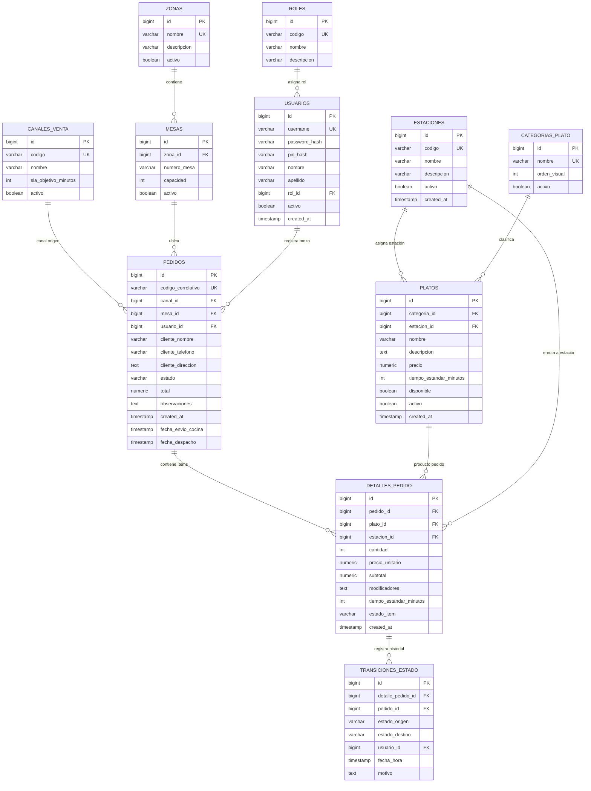

# Modelo de Datos y Contratos de API - Sistema KDS

**Proyecto:** Sistema KDS (Kitchen Display System)  
**Motor de Base de Datos:** PostgreSQL 16  
**Mapeo:** Spring Data JPA / Hibernate 6 con migraciones Flyway  
**Sprint Actual:** Sprint 1 · Fundación y Comandero  
**Versión:** 1.0.0  

---

## 1. Esquema Relacional de Base de Datos

---

## 2. Definición Detallada de Tablas y Restricciones (DDL)

### 2.1 Tablas de Seguridad y Usuarios
- **`roles`**:
  - `id`: BIGSERIAL PRIMARY KEY
  - `codigo`: VARCHAR(30) UNIQUE NOT NULL (`ADMIN`, `MOZO`, `COCINERO`, `EXPEDIDOR`)
  - `nombre`: VARCHAR(60) NOT NULL
  - `descripcion`: VARCHAR(255)
- **`usuarios`**:
  - `id`: BIGSERIAL PRIMARY KEY
  - `username`: VARCHAR(50) UNIQUE NOT NULL
  - `password_hash`: VARCHAR(255) (BCrypt, obligatorio para ADMIN)
  - `pin_hash`: VARCHAR(255) (BCrypt de 4 dígitos, obligatorio para COCINERO/MOZO)
  - `nombre`: VARCHAR(80) NOT NULL
  - `apellido`: VARCHAR(80) NOT NULL
  - `rol_id`: BIGINT REFERENCES roles(id) NOT NULL
  - `activo`: BOOLEAN DEFAULT TRUE NOT NULL
  - `created_at`: TIMESTAMP DEFAULT CURRENT_TIMESTAMP NOT NULL

### 2.2 Tablas Maestras y Configuración (Sprint 1)
- **`estaciones`**:
  - `id`: BIGSERIAL PRIMARY KEY
  - `codigo`: VARCHAR(30) UNIQUE NOT NULL (`PLANCHA`, `FRIOS`, `CALIENTES`, `BEBIDAS`, `HORNO`)
  - `nombre`: VARCHAR(80) NOT NULL
  - `descripcion`: VARCHAR(255)
  - `activo`: BOOLEAN DEFAULT TRUE NOT NULL
  - `created_at`: TIMESTAMP DEFAULT CURRENT_TIMESTAMP NOT NULL
- **`zonas`**:
  - `id`: BIGSERIAL PRIMARY KEY
  - `nombre`: VARCHAR(60) UNIQUE NOT NULL (`Salón Principal`, `Terraza`, `Barra`)
  - `descripcion`: VARCHAR(255)
  - `activo`: BOOLEAN DEFAULT TRUE NOT NULL
- **`mesas`**:
  - `id`: BIGSERIAL PRIMARY KEY
  - `zona_id`: BIGINT REFERENCES zonas(id) NOT NULL
  - `numero_mesa`: VARCHAR(20) NOT NULL
  - `capacidad`: INT DEFAULT 4 NOT NULL
  - `activo`: BOOLEAN DEFAULT TRUE NOT NULL
  - `CONSTRAINT uq_zona_mesa UNIQUE (zona_id, numero_mesa)`
- **`canales_venta`**:
  - `id`: BIGSERIAL PRIMARY KEY
  - `codigo`: VARCHAR(30) UNIQUE NOT NULL (`SALON`, `PARA_LLEVAR`, `DELIVERY`)
  - `nombre`: VARCHAR(60) NOT NULL
  - `sla_objetivo_minutos`: INT NOT NULL CHECK (sla_objetivo_minutos > 0)
  - `activo`: BOOLEAN DEFAULT TRUE NOT NULL
- **`categorias_plato`**:
  - `id`: BIGSERIAL PRIMARY KEY
  - `nombre`: VARCHAR(60) UNIQUE NOT NULL (`Entradas`, `Fondos`, `Bebidas`, `Postres`)
  - `orden_visual`: INT DEFAULT 0 NOT NULL
  - `activo`: BOOLEAN DEFAULT TRUE NOT NULL
- **`platos`**:
  - `id`: BIGSERIAL PRIMARY KEY
  - `categoria_id`: BIGINT REFERENCES categorias_plato(id) NOT NULL
  - `estacion_id`: BIGINT REFERENCES estaciones(id) NOT NULL
  - `nombre`: VARCHAR(120) NOT NULL
  - `descripcion`: TEXT
  - `precio`: NUMERIC(10, 2) NOT NULL CHECK (precio >= 0)
  - `tiempo_estandar_minutos`: INT NOT NULL CHECK (tiempo_estandar_minutos > 0)
  - `disponible`: BOOLEAN DEFAULT TRUE NOT NULL
  - `activo`: BOOLEAN DEFAULT TRUE NOT NULL
  - `created_at`: TIMESTAMP DEFAULT CURRENT_TIMESTAMP NOT NULL

### 2.3 Tablas de Comandas y Pedidos (Sprint 1 Fundación + Comandero)
- **`pedidos`**:
  - `id`: BIGSERIAL PRIMARY KEY
  - `codigo_correlativo`: VARCHAR(30) UNIQUE NOT NULL
  - `canal_id`: BIGINT REFERENCES canales_venta(id) NOT NULL
  - `mesa_id`: BIGINT REFERENCES mesas(id) (opcional si es para llevar/delivery)
  - `usuario_id`: BIGINT REFERENCES usuarios(id) NOT NULL
  - `cliente_nombre`: VARCHAR(120)
  - `cliente_telefono`: VARCHAR(30)
  - `cliente_direccion`: TEXT
  - `estado`: VARCHAR(30) NOT NULL DEFAULT 'BORRADOR'
  - `total`: NUMERIC(10, 2) DEFAULT 0.00 NOT NULL
  - `observaciones`: TEXT
  - `created_at`: TIMESTAMP DEFAULT CURRENT_TIMESTAMP NOT NULL
  - `fecha_envio_cocina`: TIMESTAMP
  - `fecha_despacho`: TIMESTAMP
- **`detalles_pedido`**:
  - `id`: BIGSERIAL PRIMARY KEY
  - `pedido_id`: BIGINT REFERENCES pedidos(id) ON DELETE CASCADE NOT NULL
  - `plato_id`: BIGINT REFERENCES platos(id) NOT NULL
  - `estacion_id`: BIGINT REFERENCES estaciones(id) NOT NULL
  - `cantidad`: INT NOT NULL CHECK (cantidad > 0)
  - `precio_unitario`: NUMERIC(10, 2) NOT NULL
  - `subtotal`: NUMERIC(10, 2) NOT NULL
  - `modificadores`: TEXT
  - `tiempo_estandar_minutos`: INT NOT NULL
  - `estado_item`: VARCHAR(30) DEFAULT 'RECIBIDO' NOT NULL
  - `created_at`: TIMESTAMP DEFAULT CURRENT_TIMESTAMP NOT NULL
- **`transiciones_estado`**:
  - `id`: BIGSERIAL PRIMARY KEY
  - `detalle_pedido_id`: BIGINT REFERENCES detalles_pedido(id) ON DELETE CASCADE
  - `pedido_id`: BIGINT REFERENCES pedidos(id) ON DELETE CASCADE NOT NULL
  - `estado_origen`: VARCHAR(30)
  - `estado_destino`: VARCHAR(30) NOT NULL
  - `usuario_id`: BIGINT REFERENCES usuarios(id)
  - `fecha_hora`: TIMESTAMP DEFAULT CURRENT_TIMESTAMP NOT NULL
  - `motivo`: TEXT

---

## 3. Contratos de API REST (Endpoints Clave)

### 3.1 Autenticación (`/api/v1/auth`)
- **`POST /api/v1/auth/login-admin`**
  - *Request:* `{ "username": "admin", "password": "password123" }`
  - *Response (200):* `{ "token": "jwt...", "usuario": { "id": 1, "username": "admin", "rol": "ADMIN", "nombre": "Administrador" } }`
- **`POST /api/v1/auth/login-pin`**
  - *Request:* `{ "pin": "1234", "estacionId": 1 }`
  - *Response (200):* `{ "token": "jwt...", "usuario": { "id": 3, "username": "cocinero1", "rol": "COCINERO", "nombre": "Carlos", "estacion": { "id": 1, "codigo": "PLANCHA" } } }`

### 3.2 Maestros y Configuración (`/api/v1/admin`)
- **`GET /api/v1/estaciones`** -> Listado de estaciones activas.
- **`POST /api/v1/estaciones`** -> Crear estación (Admin).
- **`PUT /api/v1/estaciones/{id}`** -> Modificar estación (Admin).
- **`GET /api/v1/zonas`** -> Listado de zonas con sus mesas activas.
- **`POST /api/v1/mesas`** -> Alta de mesa en una zona (Admin).
- **`GET /api/v1/canales`** -> Canales de venta y sus tiempos SLA.
- **`PUT /api/v1/canales/{id}/sla`** -> Actualizar SLA del canal (Admin).
- **`GET /api/v1/categorias`** -> Categorías de platos.
- **`GET /api/v1/platos`** -> Listado de platos (con filtros por categoría y búsqueda).
- **`POST /api/v1/platos`** -> Crear nuevo plato (Admin).
- **`PUT /api/v1/platos/{id}`** -> Editar plato / cambiar disponibilidad (Admin).

### 3.3 Comandero y Pedidos (`/api/v1/pedidos`)
- **`GET /api/v1/pedidos/correlativo-siguiente`** -> Devuelve el siguiente código sugerido.
- **`POST /api/v1/pedidos`** -> Crear o abrir comanda borrador (Mozo).
- **`POST /api/v1/pedidos/{id}/items`** -> Agregar o modificar ítems de la comanda.
- **`GET /api/v1/pedidos/{id}`** -> Obtener comanda con sus ítems calculados.

---

## 4. Políticas de PII, Seguridad y Lineage de Datos

1. **Protección de Credenciales (PII y Autenticación):**
   - Las contraseñas y PINs jamás se devuelven en respuestas JSON (anotadas con `@JsonProperty(access = JsonProperty.Access.WRITE_ONLY)` o separadas en DTOs de autenticación).
   - El PIN de cocina no se guarda en texto plano; se utiliza BCrypt con sal propia.
2. **Datos de Clientes en Delivery:**
   - Para pedidos externos y delivery, los campos `cliente_nombre`, `cliente_telefono` y `cliente_direccion` se almacenan únicamente con fines de despacho operativo y se purgan tras el cierre del servicio o se anonimizan en reportes agregados.
3. **Auditoría y Trazabilidad:**
   - La tabla `transiciones_estado` asegura trazabilidad inmutable de quién y cuándo modificó cada plato o comanda para cálculo de métricas de desempeño y tiempos reales en Sprint 4.
